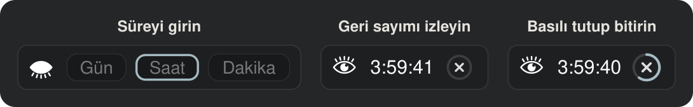
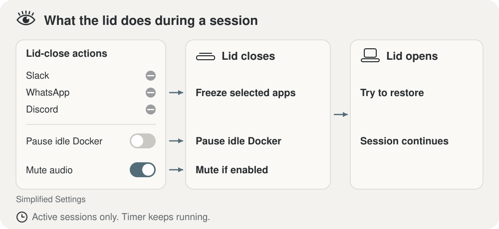
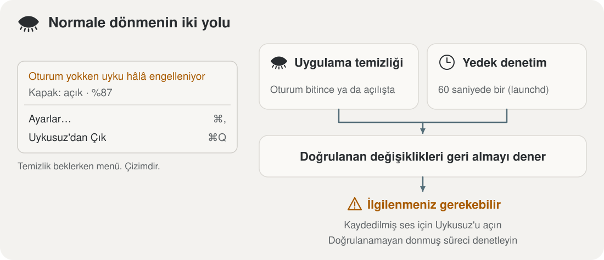

<p align="center">
  
</p>

<h1 align="center">Uykusuz</h1>

<p align="center">
  <strong>Mac'iniz uyanık kalsın, işiniz yarıda kalmasın.</strong>
</p>

<p align="center">
  
  
  
  
</p>

<p align="center">
  Uykusuz, Mac'inizi süreli oturumlarla uyanık tutan bir macOS menü çubuğu
  uygulamasıdır. Kapak kapalıyken bile uzun derlemeler, indirmeler ve Claude
  Code görevleri kesintisiz sürer; oturum bitince Uykusuz yaptığı
  değişiklikleri geri alır ve Mac normal uykusuna döner. Dock simgesi ve ana
  penceresi yoktur: menü çubuğunda duran bir gözden ibarettir.
</p>

<p align="center">
  <a href="#özellikler"><strong>Özellikler</strong></a> ·
  <a href="#kurulum"><strong>Kurulum</strong></a> ·
  <a href="#kullanım"><strong>Kullanım</strong></a> ·
  <a href="#claude-ile-otomatik-oturum"><strong>Claude ile otomatik oturum</strong></a> ·
  <a href="#kapak-kapanınca-neler-olur"><strong>Kapak kapanınca</strong></a> ·
  <a href="#kurtarma-nasıl-çalışır"><strong>Kurtarma</strong></a> ·
  <a href="#katkıda-bulunma"><strong>Katkıda bulunma</strong></a>
</p>

<p align="center">
  
</p>

> ⚠️ **Mac'i kapalı bir çantada değil, sabit ve iyi havalanan bir yüzeyde
> kullanın.** Uyku kapalıyken Mac kapak kapalıyken de çalışmayı sürdürür ve
> ısınabilir. Uykusuz deneysel bir yazılımdır: kurtarma başarısız olabilir ve
> çalışan bir zamanlayıcı bir güvenlik garantisi değildir.
> [Apple'ın havalandırma önerileri](https://support.apple.com/en-us/102336) ·
> [Gerçek Mac doğrulamaları](docs/release-validation.md) (İngilizce)

## Neden Uykusuz?

macOS, kapak kapanınca Mac'i uyutur. Çantadaki bir dizüstü için doğru davranış
budur; ama Claude Code saatlerdir bir görev yürütürken, bir derleme sürerken ya
da büyük bir indirme beklerken iş yarıda kalır. Uyku ayarını kalıcı olarak
kapatmak ise unutulduğunda pili bitirir ve Mac'i boşuna ısıtır.

Uykusuz ikisinin arasında durur: uykuyu yalnızca sizin belirlediğiniz süre
boyunca engeller, kapak kapalıyken gereksiz her şeyi (ekran, ses, arka plandaki
uygulamalar) susturur ve süre dolunca Mac'i bıraktığınız gibi geri verir.
Claude çalışırken bunu kendiliğinden de yapar.

## Özellikler

- **Süreli oturumlar.** Menü çubuğuna gün, saat ve dakika yazıp Enter'a basın.
  Süre eklemek bir tık, erken bitirmek basılı tutmak kadar kolaydır. Bir oturum
  en çok 30 gün sürer.
- **Kapak kapalıyken çalışma.** Oturum boyunca Mac, kapağı kapalıyken de uyumaz.
- **Claude ile otomatik oturum.** Claude Code bir görev yürüttüğü sürece oturum
  kendiliğinden açılır, uzar ve Claude durunca kapanır; Claude sizden yanıt
  beklerken bir süre sonra kapanır ve istediğinizde belli bir süre duraklatılır.
- **Sen yokken özeti.** Kapak ya da kilit açılınca Claude'un siz yokken yaptıkları küçük bir
  pencerede bir iki cümleyle anlatılır; ▶ ile dinlersiniz, okunan kelime
  vurgulanır ve çubukla ileri geri gidersiniz; bir Claude API anahtarı
  kaydederseniz özeti Claude yazar.
- **Telefondan yanıt.** Claude oturumlarını iPhone'daki Claude uygulamasından
  yanıtlar ve onaylarsınız; Uykusuz, Claude'un telefon bildirimlerini yalnızca
  siz uzaktayken gönderir ve yanıtınız gelene kadar Mac'i uyanık tutar.
- **Claude sizi beklerken iPhone'a haber.** Kapak kapalıyken, ekran kilitliyken
  ya da Mac'e bir süredir dokunulmadıysa, bir Claude oturumu onay ya da yanıt
  beklemeye başlayınca veya işini bitirince Uykusuz telefonunuza iMessage gönderir.
- **Kapak eylemleri.** Kapak kapanınca ekran ve klavye ışığı söner, seçili
  uygulamalar dondurulur, ses kapanır ve Düşük Güç Modu açılır; kapağı açmak
  hepsini geri almaya çalışır.
- **Kod modu ve boşta siyah ekran.** Oturum sürerken kapak açıksa ve Claude
  çalışıyorsa Düşük Güç Modu açılır; bir süre girdi olmazsa ekran tamamen
  kararır ve bir tuşla geri gelir.
- **Türkçe sesli uyarılar.** Kapak kapalıyken bildirimler görünmediği için pil,
  ısı ve oturum sonu uyarıları sesli söylenir; Mac'te kurulu en iyi Türkçe ses
  kullanılır.
- **Pil ve ısı korumaları.** Pil %30'un altına inince Düşük Güç Modu açılır,
  %20'nin altında oturum biter; Mac aşırı ısınırsa oturum kendiliğinden kapanır.
- **Güvenli geri alma.** Her değişiklik önce diske kaydedilir. Uygulama çökse
  bile her dakika çalışan bir kurtarma ajanı Mac'i eski hâline döndürmeye
  çalışır.
- **Ağ yedekleme.** Wi-Fi koparsa iPhone'unuzun kişisel erişim noktasına
  geçebilir; isterseniz tmux'ta çalışan kodlama ajanınıza `continue` yazar.
- **Gizlilik.** Uykusuz yalnızca siz bir Claude API anahtarı kaydettiyseniz ve
  yalnızca "Sen yokken" özetini yazdırmak için `api.anthropic.com`'a istek
  yapar; başka hiçbir ağ isteği yapmaz. Ayarlar ve günlükler yalnızca sizin
  hesabınızın okuyabildiği dosyalarda, anahtar giriş Anahtar Zinciri'nde tutulur.

## Gereksinimler

- macOS 26 ya da üstü.
- Apple Silicon (Apple çipli) bir Mac. Intel bir Mac'te kaynaktan derleme
  denenmemiştir.
- Swift 6.2 ya da üstünü içeren Xcode.

## Kurulum

Uykusuz kaynak koddan derlenerek kurulur. Depoyu klonlayın, kurulum betiğini
çalıştırın ve uygulamayı açın:

```bash
git clone https://github.com/Mustafa-Ghn/uykusuz.git && cd uykusuz && ./scripts/install.sh
open "$HOME/Applications/Uykusuz.app"
```

SSH anahtarı kullanıyorsanız `git@github.com:Mustafa-Ghn/uykusuz.git`
adresiyle klonlayın.

`./scripts/install.sh`, uygulamayı bu çalışma kopyasından derler
(`scripts/build-app.sh`, ad-hoc imzalı) ve kurar. sudoers kuralı için
parolanızı bir kez sorar; bu istem, derleme bittikten sonra ve önceki
kurulumdaki hiçbir şeye dokunulmadan önce gelir. Her adımın neyi denetlediği
[docs/install.md](docs/install.md) sayfasında anlatılır.

<details>
<summary><strong>Kurulumun Mac'inizde değiştirdikleri</strong></summary>

sudoers kuralı bir sistem dosyası olduğu için kurulum betiği parolanızı ister.
Şunları kurar:

- Uygulamayı, `~/Applications/Uykusuz.app` konumuna.
- Bir **kurtarma ajanı**: her dakika çalışan bir `launchd` görevi. Bir oturumun
  bitmesi gerektiği hâlde uygulama artık çalışmıyorsa ajan, oturumun yaptığı
  değişiklikleri geri almaya çalışır. Ajan, uygulamanın kendi programından
  başladığı için Sistem Ayarları > Genel > Giriş Öğeleri ve Uzantılar'da
  Uykusuz adıyla görünür. Uygulama ücretli bir Apple Developer ID ile
  imzalanmadığından yanında "kimliği belirsiz geliştirici" yazar.
- `/etc/sudoers.d/uykusuz` konumunda bir **sudoers kuralı**. Bir sudoers kuralı,
  kimin neyi `sudo` ile çalıştırabileceğini belirler. Bu kural, yalnızca
  Uykusuz'a değil, kullanıcı hesabınıza şu dört komutu parolasız çalıştırma
  izni verir:

```text
/usr/bin/pmset -a disablesleep 1
/usr/bin/pmset -a disablesleep 0
/usr/bin/pmset -b lowpowermode 1
/usr/bin/pmset -b lowpowermode 0
```

Sizin hesabınızla çalışan her program da bu kuralı kullanabilir; bu yüzden
kurmadan önce kuralı gözden geçirin.
[docs/install.md](docs/install.md#neler-kurulur) her dosyayı listeler ve
yükseltmelerin onları nasıl değiştirdiğini açıklar.

</details>

## Güncelleme

Uykusuz güncelleme denetlemez. Güncellemek için
çalışma kopyasında yeni değişiklikleri çekin ve kurulum betiğini yeniden
çalıştırın:

```bash
cd uykusuz
git pull
./scripts/install.sh
```

Kurulum betiği çalışan uygulamadan kapanmasını ister. Geri alınmayı bekleyen
bir değişiklik varken uygulama kapanmayı reddeder; betik o zaman durur ve
uygulamaya da kurtarma ajanına da dokunmaz. Parolanız her çalıştırmada bir kez
istenir. Kurulu sürümü Ayarlar > Uygulama gösterir; her sürümde nelerin
değiştiği [CHANGELOG.md](CHANGELOG.md) dosyasındadır. Ayrıntılar:
[docs/install.md](docs/install.md#yükseltmeler).

## Kullanım

1. **Başlatın.** Menü çubuğundaki göze tıklayın, gün, saat ve dakikayı girin ve
   Enter'a basın.
2. **Süre ekleyin.** Oturum sırasında göze ya da geri sayıma tıklayın.
3. **Erken bitirin.** Geri sayımın yanındaki bitirme denetimini basılı tutun.
4. **Ayarlar ve durum.** Göze sağ tıklayın. "Uykusuz'dan Çık", Uykusuz'un
   önce oturumu geri almasını ister; geri alınmayı bekleyen bir değişiklik
   varken Uykusuz kapanmayı reddeder. Bağlı olmayan bir çıkış aygıtı için
   kaydedilmiş ses bunu engellemez. Uykusuz o aygıtı, uygulama çalışırken
   yeniden bağlanırsa ya da bir sonraki açılışta geri yükler.

Kapağı kapatmanız gerekmez; kapağı açmak da oturumu bitirmez.

Pil gücündeyken Uykusuz, pil düzeyi %30 eşiğinin altına inince Düşük Güç
Modu'nu açar ve %20 eşiğinin altında oturumu bitirir. Bunlar varsayılan
değerlerdir. İkisini de Ayarlar'da değiştirebilirsiniz; bitirme alt sınırını 0
yapmak pil nedeniyle bitirmeyi kapatır. Isı kuralları, Mac ciddi ölçüde
ısındığında Düşük Güç Modu'nu açar ve kritik ısıda oturumu bitirir. Bu kurallar
varsayılan olarak açıktır ve Ayarlar'dan kapatılabilir. Bu kuralların hepsi
yalnızca uygulama çalışırken işler.

İlk oturumunuzdan önce Ayarlar'ı gözden geçirin. Ardından başında
durabileceğiniz kısa bir oturum çalıştırın ve sonrasında
`~/Library/Logs/Uykusuz/uykusuz.log` dosyasını okuyun.

### Ayarlar

Ayarlar penceresi göze sağ tıklayınca açılan menüden (⌘,) açılır:

| Bölüm | İçindekiler |
| --- | --- |
| Oturum | Hazır süreler, varsayılan süre, açılışta odaklanan alan, en uzun oturum |
| Kapak kapanınca yapılacaklar | Ekran ve klavye ışığı, dondurma listesi, diğer tüm uygulamalar, Docker, ses, Düşük Güç Modu, sesli uyarı, kullanılan ses ve Dinle |
| Ajan uygulamaları | Hiçbir zaman dondurulmayan ya da kısıtlanmayan uygulamalar, App Nap |
| Pil ve ısı | Düşük Güç Modu ve oturum sonu eşikleri, ısı kuralları |
| Claude, kod modu ve ekran | Claude Code hook'ları, izin isteklerini otomatik onaylama, otomatik oturum, yanıt beklerken bitirme ve bekleme süresi, kod modu, boşta siyah ekran süreleri ve kilitleme |
| Sen yokken özeti | Kapak ya da kilit açılınca özet penceresi, Claude API anahtarı, özeti yazan model, son 2 saati şimdi özetle |
| Telefondan yanıt | Claude'un telefon bildirimleri yalnızca uzaktayken, yanıt için Mac'in uyanık kalacağı süre |
| Claude sizi beklerken iPhone'a haber ver | iMessage gönder, alıcı (telefon numarası ya da Apple ID e-postası), deneme mesajı |
| Ağ yedekleme | iPhone kişisel erişim noktası, bilinen Wi-Fi ağına geri dönüş, tmux dürtmesi |
| Uygulama | Girişte aç, yapılandırma klasörü, kurulu sürüm |

## Claude ile otomatik oturum

<p align="center">
  
</p>

Claude Code bir görev yürüttüğü sürece Uykusuz kendiliğinden bir oturum açar;
menü çubuğunda geri sayım yerine **Claude** yazar. Oturum Claude çalıştıkça
sürer (arka planda 2 saatlik dilimlerle uzar) ve Claude 5 dakika çalışmayınca
biter; Mac normal uykusuna döner. Sağ tık menüsü de "Claude çalıştıkça açık;
Claude durunca 5 dk sonra biter" satırını gösterir. [Telefondan
yanıt](#telefondan-yanıt) açıkken bu süre, orada seçilen süredir (varsayılan
30 dakika).

- **Oturumu devralma.** "Claude" yazısına tıklayıp bir süre girerseniz oturum
  sizin olur: girdiğiniz süre o andan itibaren sayılır ve geri sayım görünür.
  Claude bu oturumu artık uzatmaz ve bitirmez. Süreniz dolduğunda Claude hâlâ
  çalışıyorsa otomatik oturum yeniden başlar.
- **Erken bitirme ve duraklatma.** Otomatik oturumu basılı tutarak bitirince
  menü çubuğunda bir menü açılır: otomatik oturumu **15 dakika**, **1 saat**,
  **3 saat** ya da **Saat seç…** ile seçtiğiniz saate kadar duraklatabilirsiniz
  (geçmiş bir saat seçerseniz yarının o saati kullanılır). **Duraklatma**'yı
  seçer ya da menüyü kapatırsanız Claude bir kez durup yeniden başlayana kadar
  otomatik oturum açılmaz.
- **Duraklatılmışken.** Claude çalışsa da otomatik oturum açılmaz. Menü
  çubuğunda kapalı gözün yanında küçük bir duraklatma işareti durur ve sağ tık
  menüsü "Otomatik oturum duraklatıldı; saat 23:20 itibarıyla yeniden açılır"
  gibi bir satır gösterir. Duraklatma uygulama yeniden açılsa da sürer; süre
  dolduğunda Claude hâlâ çalışıyorsa otomatik oturum hemen yeniden açılır. Sağ
  tık menüsündeki **Otomatik oturumu duraklat** alt menüsü aynı seçenekleri her
  zaman sunar (süren bir otomatik oturumu da bitirir); **Otomatik oturumu
  sürdür** duraklatmayı erken bitirir.
- **Claude yanıt beklerken.** Claude bir komut için onay, bir soru için yanıt
  ya da bir plan için onay beklerken çalışıyor sayılmaz. Bekleme süresi
  (varsayılan 5 dakika) içinde yanıt gelmezse otomatik oturum biter ve Mac
  uyur; yanıt verince oturum yeniden başlar. Kapak kapalıysa Uykusuz bunu sesle
  söyler: "Claude sizi bekliyor. 5 dakika içinde yanıt vermezseniz oturum
  biter ve Mac uyur." Onayı telefondan vermek için [Telefondan
  yanıt](#telefondan-yanıt)'ı açın; bekleme o zaman orada seçilen süre kadar
  (varsayılan 30 dakika) sürer.
- **Güvenlik payı.** Mac ısınıyorsa ya da pil gücündeyken pil, bitiş eşiğinin
  (varsayılan %20) en çok 5 puan üstündeyse otomatik oturum başlamaz.
- **Elle başlatılan oturumlar.** Kendi başlattığınız oturumlar geri sayımla
  görünür; Claude onları uzatmaz ve bitirmez.

Kapak kapansa da Mac uyanık kalır: **Mac'i kapalı bir çantaya koymayın.**
Otomatik oturum Ayarlar > Claude, kod modu ve ekran bölümünden kapatılabilir.

### Claude'un çalıştığını algılama

Ayarlar > Claude, kod modu ve ekran bölümündeki **Kur** düğmesi (ya da
`~/Applications/Uykusuz.app/Contents/MacOS/Uykusuz --install-claude-hooks`)
Claude Code hook'larını kurar. Kuruluyken Claude yalnızca bir görev yürütürken
çalışıyor sayılır: bir istek başlayıp Claude yanıtını bitirene kadar ya da
Claude'un başlattığı bir komut (arka planda bile) iş yaptığı sürece. Açık
bırakılıp boşta bekleyen bir komut, örneğin bir veritabanı bağlantı aracı ya da
geliştirme sunucusu, son 5 dakikada işlemci kullanmadıysa sayılmaz; derleme ve
test gibi işler sayılır. Hook'lar ayrıca
Claude'un bir onay penceresi açtığını, soru sorduğunu ya da plan onayı
beklediğini bildirir. Hiçbir çıktı vermezler, bu yüzden bir izne yanıt vermez ve
bir aracı değiştirmezler; tek istisna aşağıdaki otomatik onaydır. Uykusuz
açılışta, daha eski bir sürümün kurduğu hook'lara eksik olayları ekler ve
komutu değişmiş olanı yeniler. Hook'lar
`~/.claude/settings.json` dosyasına eklenir ve dosyanın eski hâli
`settings.json.uykusuz-yedek` olarak saklanır; aynı düğme (ya da
`--remove-claude-hooks`) onları kaldırır. Hook'lar kurulu değilken Claude
masaüstü uygulaması açık olduğu sürece çalışıyor sayılır.

**İzin isteklerini otomatik onaylama.** Ayarlar > Claude, kod modu ve ekran
bölümündeki **Claude'un izin isteklerini otomatik onayla** açıkken Uykusuz,
Claude'un komut çalıştırma, dosya düzenleme ve araç kullanma izinlerini sizin
yerinize hemen onaylar; plan ya da auto modunda da onay penceresi sizi
bekletmez. Claude'un soruları ve plan onayları size kalır; Claude ayarlarınızdaki
deny kuralları yine geçerlidir. Bunu, onay penceresi açılırken çalışan hook
yapar: ayar açıksa Claude Code'a "onay" yanıtı yazar, kapalıysa hiçbir şey
yazmaz ve karar size kalır. Bu, bypass moduna yakın bir güvenlik düzeyidir:
Claude'un okuduğu bir içerik onu zararlı bir komuta yönlendirirse o komut da
onaylanır. Ayar varsayılan olarak kapalıdır, hook'ların kurulu olmasını ister ve
yeni açılan oturumlarda geçerli olur.

### Telefondan yanıt

Claude oturumlarını telefondan yanıtlamanın yolu Claude'un kendi **Remote
Control** özelliğidir. Claude uygulamasında Ayarlar > Claude Code > **Connect new
sessions to Remote Control** açıkken her yeni oturum, iPhone'daki Claude
uygulamasında Code sekmesinde kendi adıyla görünür. Yazdığınız mesaj, verdiğiniz
onay ya da bir sorunun yanıtı yalnızca açtığınız oturuma gider; birden çok oturum
birbirine karışmaz. Claude da onay ya da yanıt beklerken ve bir iş bitince
telefona kendisi bildirim gönderir (Claude Code ayarlarında "Push when actions
required" ve "Push when Claude decides").

Ayarlar > Telefondan yanıt bölümündeki **Claude'un telefon bildirimleri yalnızca
ben uzaktayken gelsin** seçeneği iki şey yapar:

- **Bildirimler yalnızca uzaktayken.** Siz Mac'in başındayken Claude'un telefon
  bildirimleri susar; kapak kapalıyken, ekran kilitliyken ya da 2 dakikadır Mac'e
  dokunulmadıysa gelir. Uykusuz bunun için Claude Code'un
  `CLAUDE_CLIENT_PRESENCE_FILE` ayarını `~/.claude/settings.json` dosyasına ekler
  (dosyanın eski hâli ilk değişiklikte `settings.json.uykusuz-yedek` olarak
  saklanır) ve siz Mac'in başındayken bu ayarın gösterdiği boş dosyayı tutar.
  Seçenek yalnızca açıldıktan sonra başlayan oturumlarda geçerlidir. Kapatınca
  satır silinir; Uykusuz kapanınca dosya da silinir ve bildirimler her zamanki
  gibi gelir.
- **Yanıt için uyanık kalma.** Otomatik oturum, Claude durduktan ya da beklemeye
  başladıktan sonra seçilen süre (varsayılan 30 dakika) kadar sürer. Böylece
  kapak kapalıyken telefondan verdiğiniz yanıt Mac'i uyanık bulur. Süre dolunca
  oturum biter ve Mac uyur; Claude Code, Mac uyanınca Remote Control'e
  kendiliğinden yeniden bağlanır.

Remote Control Claude'un özelliğidir: açıkken oturumun yazışması cihazlar arası
eşitleme için Anthropic sunucularında tutulur. Uykusuz bu yazışmayı okumaz ve
yanıtları aktarmaz; yalnızca bildirimlerin ne zaman gideceğini ve Mac'in ne kadar
uyanık kalacağını belirler.

### Claude sizi beklerken iPhone'a haber

Ayarlar > Claude sizi beklerken iPhone'a haber ver bölümünde **iMessage gönder**'i
açıp alıcıya telefon numaranızı ya da Apple ID e-postanızı yazın. Kapak
kapalıyken, ekran kilitliyken ya da 2 dakikadır Mac'e dokunulmadıysa, bir Claude Code oturumu onay
ya da yanıt beklemeye başlayınca (bir komut izni, bir soru, bir plan onayı) ya
da işini bitirip yeni isteğinizi bekleyince Uykusuz bu alıcıya Mac'teki Mesajlar
uygulaması üzerinden bir iMessage gönderir. Böylece Mac'e dönüp kaldığınız yerden
devam edebilirsiniz. [Telefondan yanıt](#telefondan-yanıt) açıksa Claude'un kendi
bildirimi de gelir; ikisini birden istemiyorsanız iMessage'ı kapatın.

- **Mesajın içeriği.** Her mesaj, Claude uygulamasının kenar çubuğunda görünen
  oturum adıyla başlar; böylece birden çok oturum varken hangisinin beklediği
  bellidir. API anahtarı kayıtlıysa gerisini Claude yazar: Claude'un ne yaptığı
  ve sizden ne beklediği, en çok iki cümle. Anahtar yoksa ya da istek başarısız
  olursa Claude'un son mesajının sonu gider.
- **Ne zaman.** Bekleme ya da bitiş 45 saniye sürmeli; hemen yeni bir tura
  geçen oturum için mesaj gitmez. Mac'in başındaysanız mesaj gitmez; ama Claude
  siz başındayken beklemeye başladıysa ve 10 dakika içinde kapağı kapatır ya da
  Mac'ten uzaklaşırsanız mesaj yine gider. Durdurduğunuz bir tur, kapatılan bir
  oturum ve yanıtlanmadan kalan bir bekleme "bitti" diye bildirilmez. Her oturum
  için en çok 10 dakikada bir mesaj gönderilir.
- **İzin.** Uykusuz mesajı Mesajlar'ın kendi AppleScript komutuyla gönderir;
  ekranı ya da klavyeyi denetlemez. İlk gönderimde macOS, Uykusuz'un Mesajlar'ı
  denetlemesine izin vermenizi ister. **Deneme mesajı gönder** düğmesiyle hem
  izni verip hem telefonunuza bildirim gelip gelmediğini görebilirsiniz; kendi
  numaranıza gönderilen mesaj kendinizle olan sohbete düşer. Uygulama her
  kurulumda yeniden imzalandığı için macOS bu izni yeni bir kurulumdan sonra
  yeniden sorabilir; kurulumdan sonra bir deneme mesajı gönderin.

### Kod modu ve boşta siyah ekran

- **Kod modu.** Bir oturum sürerken kapak açıksa ve Claude çalışıyorsa Düşük
  Güç Modu açılır (pildeyken etkili).
- **Boşta siyah ekran.** Oturum sürerken kapak açıkken ekran koruyucu ve ekran
  uykusu çalışmaz. 60 sn girdi olmazsa ekran parlaklığı 0'a iner ve ekran hiç
  ışık vermez; 30 sn olmazsa klavye ışığı söner. Bir tuşa ya da fareye
  dokununca ikisi de eski seviyesine döner. Ekran karardıktan sonra 15 dakika
  dönmezseniz oturum kilitlenir: ekran koruyucu açılmaz ve ekran karanlık kalır,
  döndüğünüzde kilit ekranı gelir. Claude ve oturum çalışmayı sürdürür. Süreler
  Ayarlar > Claude, kod modu ve ekran bölümünden değişir; kilitleme süresi 0
  yapılırsa ekran kendiliğinden kilitlenmez.

### Sen yokken özeti

Kapak en az 3 dakika kapalı ya da ekran o kadar kilitli kaldıysa, döndüğünüzde
Claude Code oturumlarında o sırada olanlar ekranın sağ üstündeki küçük bir
pencerede bir iki cümleyle anlatılır. Döndüğünüz an, kapağın açık ve kilidin
açılmış olduğu andır; kapağı kilit ekranında açarsanız özet kilidi açınca gelir.
Boşta siyah ekranın kilidinde süre, Mac'e son dokunduğunuz andan sayılır.
Oturumun hâlâ sürmesi gerekmez; Uykusuz kapağı ve kilidi her zaman izler.
Ayarlar > Sen yokken özeti bölümündeki **Son 2 saati şimdi özetle** düğmesi
özeti hemen dener; göze sağ tıklayınca açılan menüdeki **Son özeti göster** son
özeti yeniden açar.

- **Pencere.** Siz ▶ düğmesine basmadan ses çıkmaz:
  kapağı sessiz bir yerde ya da başka bir iş için açmış olabilirsiniz. Okurken
  okunan kelime metinde vurgulanır; ❚❚ durdurur, ◀◀ ve ▶▶ beşer kelime geri ve
  ileri gider, çubuğu sürükleyince okuma o kelimeden sürer. Pencere öndeki
  uygulamanın odağını almaz; kapak yeniden kapanınca okuma durur ve pencere
  kapanır. Ses, sesli uyarılardaki gibi Mac'te kurulu en iyi Türkçe sestir.

- **Anahtarsız.** Claude API anahtarı kayıtlı değilse özet bu Mac'te sayılarla
  yazılır (hangi oturum, kaç dosya, kaç komut, şu anki durum) ve hiçbir yere
  gönderilmez.
- **Anahtarla.** Anahtar kayıtlıysa özeti Claude yazar (varsayılan Claude Opus
  5.5; Ayarlar'dan Sonnet 5.5 ya da Haiku 5.5 seçilebilir). Uykusuz
  `api.anthropic.com`'a tek bir istek gönderir. İstekte yalnızca oturum
  başlıkları, araçların kaç kez çalıştığı, düzenlenen dosyaların adları,
  Claude'un komutlarına yazdığı açıklamalar ve son mesajlarının sonu bulunur;
  dosya içerikleri, komut satırları ve komut çıktıları gönderilmez. İstek
  başarısız olursa yerel özet kullanılır. Gönderilecek metni önceden görmek
  için `~/Applications/Uykusuz.app/Contents/MacOS/Uykusuz --away-digest 60`
  son 60 dakikanın dökümünü ve yerel özetini yazdırır; hiçbir şey göndermez.
- **Anahtar.** Anahtar giriş Anahtar Zinciri'nde saklanır; config.json'a ve
  günlüğe yazılmaz. Uygulama her kurulumda yeniden imzalandığı için yeni bir
  kurulumdan sonra anahtarı Ayarlar'dan yeniden kaydetmek gerekir. Max ve Team
  planları her ay Claude Console'da kullanılabilen bir API kredisi içerir
  (claude.ai > Ayarlar > Faturalandırma > API credits); anahtarı harcama sınırı
  olan ayrı bir çalışma alanında oluşturun.

## Kapak kapanınca neler olur

<p align="center">
  
</p>

Oturum sırasında kapağı kapatmak aşağıdakilerin her birini yapar; kapağı açmak
bunları geri almaya çalışır. Kapak kapalıyken zamanlayıcı geri saymayı sürdürür.

- **Ekran ve klavye ışığı kapanır.** Uykusuz önce parlaklıklarını kaydeder.
  Uyku kapalıyken macOS bunu artık kendiliğinden yapmaz. Klavye ışığı zaten
  kapalıysa (macOS onu gün ışığında kendisi kapatır) Uykusuz ona dokunmaz;
  böylece akşam klavyeyi kullanmaya başlayınca macOS ışığı yine kendisi açar.
- **Uygulamalar dondurulur.** Dondurma, bir uygulamanın süreçlerine `SIGSTOP`
  gönderir; süreçler kapak açılınca `SIGCONT` gönderilene kadar duraklar.
  Dondurma listesi WhatsApp, Word, Excel ve ParaView ile başlar. "Diğer tüm
  uygulamaları dondur" da varsayılan olarak açıktır: ajan uygulamaları, Apple
  uygulamaları, Docker Desktop ve yerleşik olarak korunan uygulamalar dışındaki
  her Dock uygulaması da dondurulur. Korunanlar arasında düzenleyiciler,
  terminaller, tarayıcılar, yapay zekâ uygulamaları, parola yöneticileri,
  Tailscale, ProtonVPN, AnyDesk ve toplantı, kayıt ve dikte uygulamaları
  (Zoom, Teams, Webex, FaceTime, Wispr Flow, Granola, Otter, OBS ve Loom) vardır.
- **Ses kapatılır.** Kapağı açmak, Uykusuz'un sesini kapattığı her çıkışın
  sesini, siz başka bir çıkışa geçmiş olsanız bile yeniden açar.
- **Düşük Güç Modu açılır.** Bir pil ya da ısı kuralı hâlâ gerektirmiyorsa
  kapak açılınca kapanır.
- **Uyarılar sesli söylenir.** Kapak kapalıyken bildirimler görünmediği için
  pil eşiği, ısınma ve oturum sonu Türkçe sesle söylenir: Uykusuz sesi bir an
  açar, uyarıyı söyler ve eski ses ayarını geri koyar. Mac'te kurulu en iyi
  Türkçe ses kullanılır: Premium, yoksa Gelişmiş, yoksa macOS ile gelen basit
  Yelda. Daha doğal bir ses için Sistem Ayarları > Erişilebilirlik >
  Seslendirilen İçerik > Sistem sesi bölümünden "Yelda (Gelişmiş)" sesini
  indirin; Uykusuz onu yeniden başlatmadan kullanmaya başlar. Ayarlar'da
  kullanılan ses görünür ve **Dinle** düğmesi onu çalar.
- **Çalışan kapsayıcı yoksa Docker Desktop duraklatılır.** Bu seçenek
  varsayılan olarak kapalıdır.

Apple çipli ya da T2 çipli Mac dizüstü bilgisayarlarda kapağı kapatmak,
yerleşik mikrofonun bağlantısını donanım düzeyinde keser. Kapak kapalıyken bir
toplantıyı kaydetmek için AirPods ya da harici bir mikrofon gerekir.

[docs/lid-close.md](docs/lid-close.md) ayrıntıları içerir: Docker'ın nasıl
denetlendiği, parlaklığın nasıl geri yüklendiği, yükseltmede bir kez yapılan
ayar değişikliği ve kapak eylemlerinin kapağı kapatmadan nasıl denendiği.

## Kurtarma nasıl çalışır

<p align="center">
  
</p>

Uykusuz her değişikliği yapmadan önce bir **kurtarma kayıt defterine**, yani
diskteki bir dosyaya yazar. Oturumu bitirmek, kayıt defterinde listelenenleri
geri almayı dener. Uygulama çökerse ya da kapanırsa, oturumun bitiş zamanı
geçtikten sonra kurtarma ajanı aynısını dener.

Bazı durumlarda sizin ilgilenmeniz gerekir:

- Kurtarma ajanı sesi geri yükleyemez. Bunun için Uykusuz'u yeniden açın.
- Kurtarma ajanı pili ya da sıcaklığı izlemez.
- Uykusuz yalnızca dondurduğunu kanıtlayabildiği bir süreci çözer.
  Kanıtlayamadığı dondurulmuş bir süreç, siz denetleyene kadar donmuş kalır.

Menüde bir kurtarma uyarısı görünürse Mac'i başında kimse olmadan bırakmadan
önce onunla ilgilenin. [docs/recovery.md](docs/recovery.md) her durumu
açıklar.

## Ek özellikler

<details>
<summary><strong>iPhone kişisel erişim noktasına geçiş ve tmux</strong></summary>

Oturum sırasında Wi-Fi bağlantısı koparsa Uykusuz, iPhone'unuzun kişisel
erişim noktasına (hotspot) katılabilir. Sistem Ayarları > Wi-Fi >
"Erişim noktalarına katılmak için sor" (Ask to join hotspots) seçeneğini
Otomatik yapın, ardından hotspot adını ve parolasını Uykusuz'un Ayarlar
penceresine girin. Parola giriş anahtar zincirinizde saklanır. macOS, Wi-Fi
ağ adlarını okumak için Konum Servisleri iznini şart koştuğundan Uykusuz bu
izni ister. Konumunuzu hiçbir zaman okumaz. Uykusuz'u yeniden kurduktan sonra
parolayı yeniden girin. Hotspot ayarlıyken Ayarlar, "Erişim noktalarına katılmak
için sor" seçeneğinin Otomatik olup olmadığını denetler; değilse turuncu bir
uyarıyla Wi-Fi ayarlarını açan bir düğme gösterir ve oturum başlarken bunu
günlüğe yazar.

Hotspot'tayken bilinen bir Wi-Fi ağının yanına dönünce Uykusuz Wi-Fi'ye kendisi geri döner
(Ayarlar'daki **Bilinen Wi-Fi ağına geri dön**, varsayılan olarak açık). Oturum
sürerken 2 dakikada bir çevreyi tarar. Daha önce bağlandığınız ve parolası olan
bir ağ yeterince güçlüyse yalnızca hotspot'tan ayrılır; macOS o ağa kendi kayıtlı
parolasıyla bağlanır. Uykusuz ağ seçmez, Wi-Fi parolalarını görmez ve daha önce
bağlanmadığınız bir ağa hiçbir zaman yönelmez. Çevrede bilinen parolasız bir ağ
varsa hotspot'tan ayrılmaz; macOS yine de parolasız bir ağa bağlanırsa Uykusuz
oradan ayrılıp hotspot'a döner. Başarısız bir denemeden sonra 10 dakika bekler.
macOS'un parolasız ağlara hiç kendiliğinden katılmasını istemiyorsanız bu ağları
Sistem Ayarları > Wi-Fi > Bilinen Ağlar'dan unutun ya da Otomatik Katıl'ı kapatın.

Ağ 90 saniye boyunca kesik kalırsa Uykusuz, bir kodlama ajanının çalıştığı bir
tmux bölmesine `continue` da yazabilir. Yalnızca Ayarlar'da listelediğiniz ve
kendiniz işaretlediğiniz bölmelere yazar:

```bash
tmux set-option -p -t <oturum:pencere.bölme> @uykusuz-nudge on
```

Siz açmadıkça Enter'a basmaz. İçine yazı yazmadığınız bir bölmeyi işaretleyin.
[docs/extras.md](docs/extras.md) ayrıntıları içerir.

</details>

<details>
<summary><strong>Chrome, Chromium, Arc ve Comet kısıtlaması</strong></summary>

Bu tarayıcılar, macOS'in gizli olarak bildirdiği pencereleri yavaşlatır; kapak
kapalıyken bu, tüm pencereler demektir. Çalışan bir tarayıcıda
`--disable-backgrounding-occluded-windows` ya da
`--disable-renderer-backgrounding` yoksa sağ tıklama menüsü "Kısıtlamasız
yeniden başlat: [tarayıcı]" seçeneğini sunar. Yeniden başlatma tarayıcıyı
kapattığı için önce sorar; sekmeler yalnızca tarayıcı açılışta onları yeniden
açıyorsa geri gelir. Bazı web uygulamaları kapak kapalıyken yine de durabilir.
[docs/extras.md](docs/extras.md#chrome-chromium-arc-ve-comet-kısıtlaması)
ayrıntıları içerir.

</details>

<details>
<summary><strong>Yapılandırma ve gizlilik</strong></summary>

Ayarlar `~/Library/Application Support/Uykusuz/config.json` dosyasında,
günlükler `~/Library/Logs/Uykusuz/` klasöründe tutulur. Uykusuz iki klasörü
ve içlerindeki dosyaları yalnızca sahibinin erişebileceği izinlere ayarlar.
Sembolik bağlantılara ve erişim denetim listelerine (ACL'ler, hesap başına ek
izin girdileri) dokunmaz; bu yüzden başka bir hesap bunlardan biri aracılığıyla
yine de erişebilir. Günlükler Wi-Fi adları, süreç ayrıntıları ve tmux hedefleri
içerebilir; bu yüzden bir günlüğü paylaşmadan önce gözden geçirin. Uykusuz'un
ağ istekleri yalnızca isteğe bağlı iki özelliktedir: Claude API anahtarı
kaydettiyseniz "Sen yokken" özeti ve iPhone'a gidecek mesaj için
`api.anthropic.com`'a gidilir (bkz. [Sen yokken özeti](#sen-yokken-özeti));
iMessage'ı Mac'teki Mesajlar uygulaması gönderir (bkz.
[Claude sizi beklerken iPhone'a haber](#claude-sizi-beklerken-iphonea-haber)).
[docs/extras.md](docs/extras.md#yapılandırma-ve-gizlilik) ayrıntıları içerir.

</details>

## Kaldırma

Çalışma kopyanızdan:

```bash
./scripts/uninstall.sh          # uygulamayı, ajanı ve sudoers kuralını kaldırır
./scripts/uninstall.sh --purge  # ayarları ve günlükleri de kaldırır
```

Kaldırma betiği önce açık kalan oturumu geri alır ve bunu yapamazsa hiçbir şey
kaldırmadan durur. sudoers kuralını kaldırmak için parolanızı ister.
[docs/install.md](docs/install.md#kaldırma) ayrıntıları içerir.

## Proje yapısı

```text
Sources/Uykusuz/
  Core/      oturum yönetimi, uyku koruması, kapak eylemleri, Claude oturumu, kurtarma
  Model/     ayarlar, oturum ve kurtarma kayıt defteri
  Store/     dosyaların yeri ve yalnızca sahibine açık izinleri
  System/    macOS ile konuşan katman: güç, ekran, ses, dondurma, ağ, Claude hook'ları
  UI/        menü çubuğu, sağ tık menüsü ve Ayarlar penceresi (SwiftUI)
scripts/     kurulum, kaldırma, kurtarma (backstop.sh) ve simge betikleri
Tests/       XCTest paketi: sahte araçlar ve geçici klasörlerle çalışır
docs/        kullanım ve tasarım belgeleri
```

## Geliştirme

```bash
swift build
swift test
```

Testler sahte araçlar ve geçici klasörler kullanır; bu yüzden güç ayarlarınızı
hiçbir zaman değiştirmez. Tasarım notları [docs/spec.md](docs/spec.md),
gerçek Mac doğrulamaları [docs/release-validation.md](docs/release-validation.md)
dosyasındadır (ikisi de İngilizce).

## Katkıda bulunma

Hata bildirimleri ve öneriler için bir issue açın. Yeni bir özelliğe ya da bir
varsayılanı değiştirmeye başlamadan önce issue'da konuşmak işleri hızlandırır.
Kod göndermeden önce [CONTRIBUTING.md](CONTRIBUTING.md) dosyasını okuyun:
testler, betik denetimleri ve gerçek Mac'te doğrulama beklentileri orada
anlatılır.

## Güvenlik

Bir güvenlik açığı bulduğunuzu düşünüyorsanız herkese açık bir issue açmak
yerine [SECURITY.md](SECURITY.md) dosyasındaki yolu izleyin. Uygulamanın
yetkileri, kalıcı bileşenleri ve tuttuğu veriler
[GUVENLIK-INCELEMESI.md](GUVENLIK-INCELEMESI.md) dosyasında incelenir.
